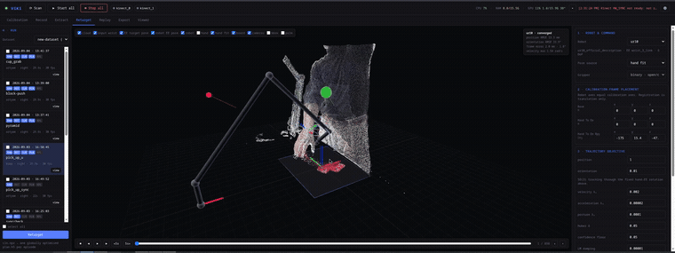

# ViKi — Video-to-Kinematics

> An offline research pipeline for turning human RGB-D demonstrations into
> robot trajectories and, next, rendered synthetic datasets.

[](LICENSE)


ViKi records or imports calibrated multiview RGB-D demonstrations, reconstructs
hand and rigid-object motion, and fits robot trajectories with whole-trajectory
inverse kinematics. The current output is a versioned trajectory bundle with
geometry, timing and provenance.

The thesis develops this into a route for **synthetic robot dataset generation**:
reuse one human demonstration across robot embodiments, camera viewpoints and
appearance configurations through **3D Gaussian Splatting (3DGS)** reconstruction
and robot compositing. Those rendering and generation stages are planned;
the existing point-cloud Viewer does not implement them.



*The current Retarget viewer shows recorded point clouds and hand motion beside
the robot model following the retargeted trajectory.*

## Research scope

The research question is how reliably reconstructed human hand–object motion
can be reused across target robots and rendered observation conditions. The
intended workflow is:

```text
Human multiview RGB-D demonstration
  → hand and object reconstruction                 implemented
  → robot-specific kinematic retargeting           implemented, task-dependent
  → 3DGS scene assets and robot compositing         planned
  → embodiment × viewpoint × appearance variants   planned
  → synchronised synthetic observations and actions
```

Evaluation separates hand/object tracking error, retargeting feasibility,
novel-view image/depth quality, compositing consistency and accepted dataset
yield. M×K×P counts requested variant configurations; some may fail reach,
visibility or consistency checks. It does not count independent human
recordings or establish a benefit for policy learning.

The current thesis scope covers reconstruction, retargeting, rendering and
their interfaces. Policy training and task-success trials are separate work.
MuJoCo scripts remain useful diagnostics; solver convergence, simulated contact
and plausible images are distinct measurements.

See the [thesis introduction](paper/thesis/chapters/chapter1.tex),
[current architecture audit](docs/2026-11-20-architecture-and-3dgs-audit.md) and
[roadmap](docs/roadmap.md) for the questions, interfaces and next experiments.

## What works today

| Area | Current state |
|---|---|
| Capture and calibration | RealSense/Azure Kinect recording, timestamps, saved camera geometry, ChArUco calibration and validation |
| Hand perception | MediaPipe/RTMPose backends, multiview triangulation, preparation checkpoints and articulated hand fitting |
| Scene perception | Explicit CUDA SAM 2.1 stage, semantic RGB-D lift, compact rigid core/shell models and pose/confidence tracks |
| Robot trajectories | PINK/Pinocchio whole-trajectory IK, joint/velocity limits, floor and self-collision checks; additional scene constraints in explicit tracked-object mode |
| Object-aware retargeting | Local UR10/Robotiq cube mode and a separate HO-Cap tracked-object pilot; prerequisites and unsupported cases fail explicitly |
| External evaluation | HO-Cap import, hand/object metrics, pinned PnP cohort, numerical reports and source provenance |
| Export | NPZ trajectory bundle and JSON manifest; optional object-model and object-relative sidecars |
| Interfaces | CLI plus FastAPI and a plain-JS web UI with a shared Three.js Viewer |
| Simulation experiments | Separate MuJoCo/Shadow/Tesollo and command-search scripts; outcomes and failures documented per experiment |

**Remaining work:** 3DGS reconstruction, robot compositing, named plans for
multiple embodiments, synthetic observation–action export and reliable web
management of long reconstruction runs. LeRobot export is partial; its
object-relative annotation is still a placeholder.

HO-Cap supplies semi-automatic MANO/object reference annotations. Object results
using oracle masks and first-frame reference alignment describe relative
tracking under those inputs. Local rig consistency and IK tracking errors are
not absolute accuracy measurements. Historical local results whose source
artifacts were lost are retracted in [the evidence record](paper/README.md).

## Pipeline and artifacts

Each stage reads an episode directory and writes durable artifacts:

```text
raw/ → rec.npz → cln.npz → plan.h5 → trajectory bundle
  ├→ cloud/                                    Viewer artifact
  └→ SAM masks → semantic cloud → object_models.npz
                      + cln.npz + plan.h5 → object_relative.npz
```

`viki perceive` combines extract and prepare with a versioned profile. `viki
scene` means SAM/object perception, not Gaussian reconstruction. The proposed
GS branch will consume recorded RGB-D, calibration and masks, then combine its
assets with object tracks and named robot plans.

The default trajectory bundle requires a completed plan, not a task-success
verdict. Its manifest records what ran. The optional CLI `viki replay` performs
an offline dry-run only: legacy `*_attained` fields contain copies of planned
values. It is not part of `viki run` or the web UI.

Package contracts and frame conventions are described in
[`viki/README.md`](viki/README.md) and [`docs/math.md`](docs/math.md).

## Running ViKi

Everything runs through Docker. Camera SDKs live in the image. The supplied
Compose configuration requests NVIDIA GPU access; SAM requires CUDA, while
hand processing and IK also contain CPU paths. Existing episodes can be
processed without cameras attached.

```bash
sudo ./scripts/host_setup.sh   # once on a capture host
docker compose up --build     # UI + API at http://localhost:8000
```

For camera capture, read [SETUP_GUIDE.md](SETUP_GUIDE.md) first. Two Azure
Kinects on the current rig require **independent PCI xHCI controllers** and a
sync cable. Different sockets on one controller are insufficient. The verified
layout uses Intel motherboard + Renesas PCIe controllers.

The web tabs are Calibration, Record, Extract, Retarget, Export and Viewer.
Capture is live; perception, retargeting and export operate on recorded episodes.

### Process an existing episode

Replace the example episode path with an existing recording or imported episode:

```bash
EPISODE=data/episodes/your-episode

docker compose run --rm cli perceive "$EPISODE" --profile stable-fused-hand-v4
docker compose run --rm cli retarget "$EPISODE" --no-object-grasp
docker compose run --rm cli export "$EPISODE" --out data/exports/your-dataset
```

This explicit hand-only path does not require object segmentation. The default
UR10/Robotiq cube mode needs a supported transfer and a tracked object labelled
`manipulated_object`; clicking Retarget does not run SAM automatically.
With a reviewed prompt manifest, run the scene branch first:

```bash
docker compose run --rm sam2 scene "$EPISODE" --prompts data/prompts/scene.json
docker compose run --rm cli retarget "$EPISODE" --object-grasp
docker compose run --rm cli object-relative "$EPISODE"
```

See [scene perception](viki/perception/README.md#scene-perception) and
[retargeting](viki/retarget/README.md) for prompt roles, supported geometry and
the separate HO-Cap object-track mode. `viki run` orchestrates extract, prepare,
optional scene perception, retarget and optional object-relative tracks;
labelling and export are explicit steps.

### HO-Cap data

[`tools/hocap_pnp_plan.json`](tools/hocap_pnp_plan.json) pins 28 single-hand
PnP sequences (24 right, 4 left), archive sizes, SHA-256 hashes and the source
revision. [`tools/download_hocap_pnp.py`](tools/download_hocap_pnp.py) downloads
that cohort with resume and hash verification. It downloads the entire plan,
so reserve enough disk space; it does not start processing the recordings.

Import and batch recipes are in the
[benchmark README](viki/benchmark/README.md) and
[pinned batch protocol](docs/2026-10-13-hocap-batch-protocol.md).
The eight-view cohort and selected two-view controls use a ViKi-specific
protocol, not the official HO-Cap leaderboard split.

### Export format

The default export is readable with NumPy and JSON, without a policy-training
framework:

```text
<out>/dataset.json
<out>/episodes/<id>/trajectory.npz
<out>/episodes/<id>/meta.json
<out>/episodes/<id>/object_models.npz      optional
<out>/episodes/<id>/object_relative.npz    optional
```

It contains joint motion, target and FK-derived tool poses, gripper commands,
source hand poses, evidence weights and provenance. It does not yet contain
rendered robot-camera observations. Details and partial LeRobot eligibility
are in the [export README](viki/export/README.md).

## What you must supply yourself

Recordings, rig calibration, model weights and robot descriptions are not
bundled. Tracked numerical evidence under `paper/results/` is separate from
those external inputs.

| Input | How it is supplied |
|---|---|
| Episodes and camera calibration | Record/calibrate locally, or import an external dataset into `data/` |
| Robot and gripper descriptions | `robot_descriptions` fetches URDFs on first use; the standard gripper is Robotiq 2F-85; other catalogue entries remain disabled pending assets/audits |
| Hand-pose weights | MediaPipe and RTMPose download on first use; heatmap ONNX variants need user-supplied converted models |
| SAM 2.1 checkpoint | Put the supported official checkpoint in `models/sam2/`; the scene stage verifies its hash |
| Configuration | `data/user_configuration.json` is initialised from tracked defaults; changes require a restart |
| Simulator assets | Restore the models and source episodes required by the chosen `experiments/` runner |
| LeRobot dependencies | Optional `viki[export]`; the writer remains partial |

`data/` and `models/` runtime contents are ignored by Git. Never commit local
recordings, weights or an active rig configuration. Shadow/Tesollo diagnostic
assets are separate from the standard gripper registry.

## Development and profiling

```bash
docker compose run --rm test
docker compose run --rm terminal
```

The source is bind-mounted; Python changes apply on container restart.
Dependencies and Dockerfile changes require rebuilding the image. Check changed
frontend modules with `node --check`; there is no frontend build step.

[`scripts/profile_viki_stage.py`](scripts/profile_viki_stage.py) records wall/CPU
time, process/thread counts and memory for one subprocess stage. Optional GPU
samples describe the whole device and are not attributed to that process.
The [compute audit](docs/2026-11-20-compute-and-parallelism-audit.md) maps existing
CPU/GPU paths, worker budgets, historical measurements and the next profiling
protocol. GS training/rendering is intended to use a separate CUDA image.

## Documentation

| Document | Purpose |
|---|---|
| [Architecture and 3DGS audit](docs/2026-11-20-architecture-and-3dgs-audit.md) | Package state, artifact boundaries, proposed reconstruction/synthesis APIs and CLI/web integration |
| [Compute and parallelism audit](docs/2026-11-20-compute-and-parallelism-audit.md) | CPU/GPU execution, existing pools and measurement protocol |
| [Roadmap](docs/roadmap.md) | Current next steps and dated historical plans |
| [Thesis](paper/README.md) | Research text, build instructions and retained/retracted evidence |
| [Mathematics](docs/math.md) | Pipeline models and coordinate conventions |
| [Retarget experiments](docs/robust_retarget_experiments.md) | Measurement protocols and results |
| [Experiment runners](experiments/README.md) | MuJoCo diagnostics and their required inputs |
| [v0.0.2 release](docs/releases/v0.0.2.md) | Historical release scope and measurements |
| [Capture setup](SETUP_GUIDE.md) | Hardware bring-up, USB topology and synchronisation |

## License

ViKi source code is [Apache-2.0](LICENSE). Third-party SDKs, datasets, model
weights and robot assets retain their own terms. Open asset/licence items are
tracked in [docs/licensing_todo.md](docs/licensing_todo.md).
